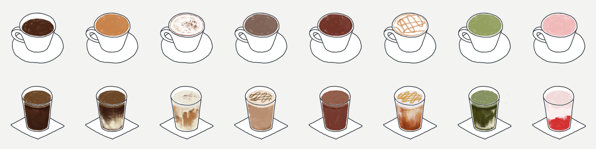
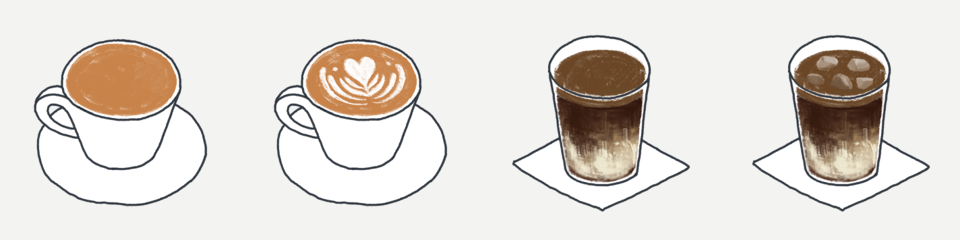

# CUPPO case study — English

<!-- English text for case-study.md. Same section IDs and patterns. -->

## Concept <!-- case.section.concept -->

One cup, one card

A coffee journal that lays hand-drawn coffee illustrations on a paper texture and treats each landscape card like a frame of film.

## Color & type <!-- case.section.color-type -->

Palette and type

@system

## Illustration <!-- case.section.illustration -->

Coffee illustration collection

The eight coffee types are shown hot or iced, with optional whipped cream or extra ice to create variations of each card.

@stack

## case.system.palette <!-- case.system.palette -->

- `#F3F3F1` Paper · light
- `#2C2C2B` Paper · dark
- `#1F1F1E` Ink
- `#EDEDEA` Ink · dark
- `#333333` Film dark
- `#8A5A3A` Coffee brown
- `#C08A5C` Brown · dark

## case.system.type <!-- case.system.type -->

- 22 / 300 | Jost · FEBRUARY | Month header
- 20 / 400 | Gowun Dodum · 오후 3시의 리셋 | Record title
- 16 / 400 | Gowun Dodum · 오늘의 커피는? | Body, inputs
- 14 / 400 | Card title · label · button | Mixed
- 12 / 400 | #아메리카노 · 2022.02.10 | Tags, dates, captions

## case.intro <!-- case.intro -->

We explored how to capture the experience around each cup of coffee in one place and revisit it over time.
