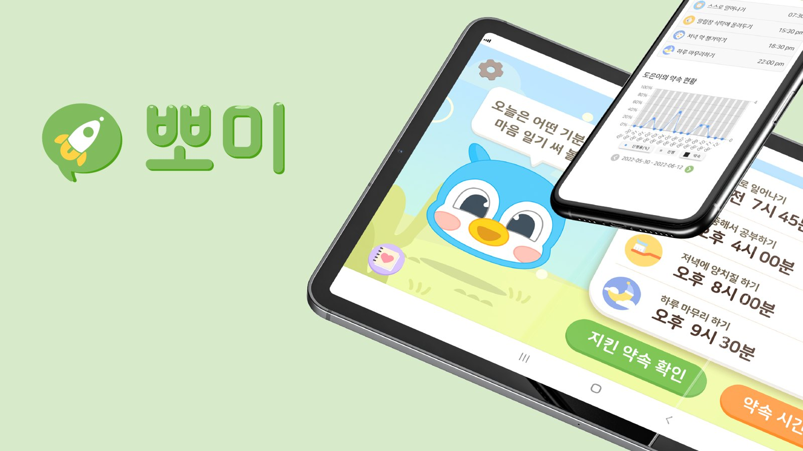
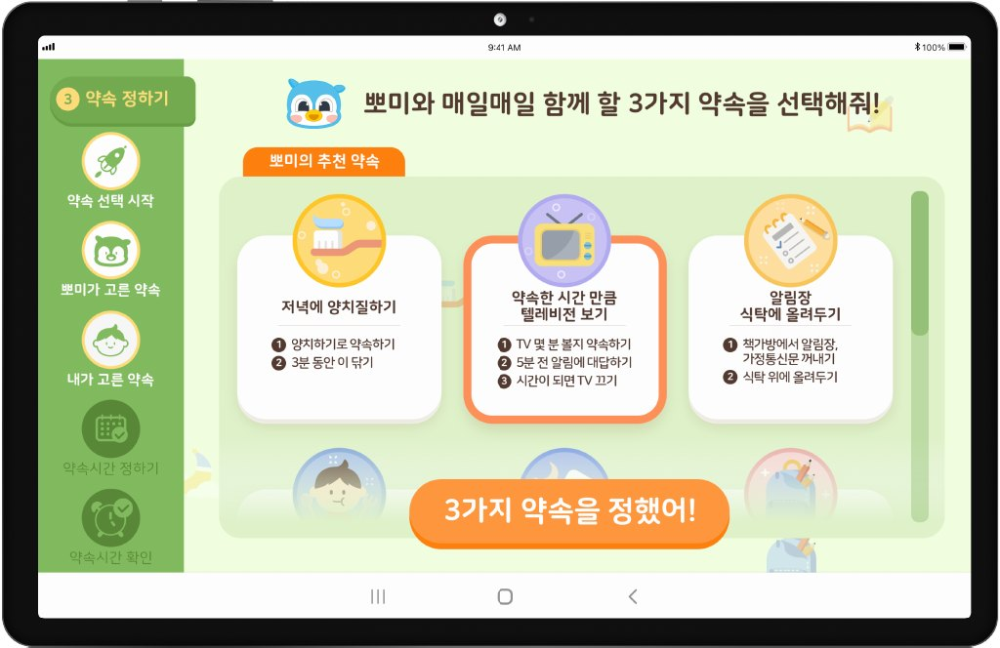
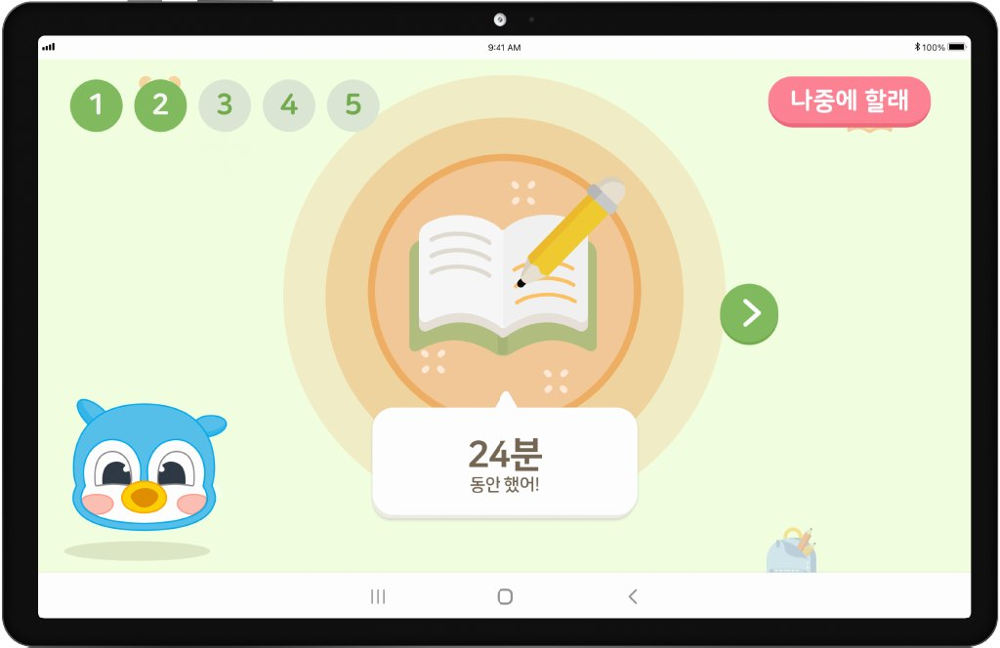
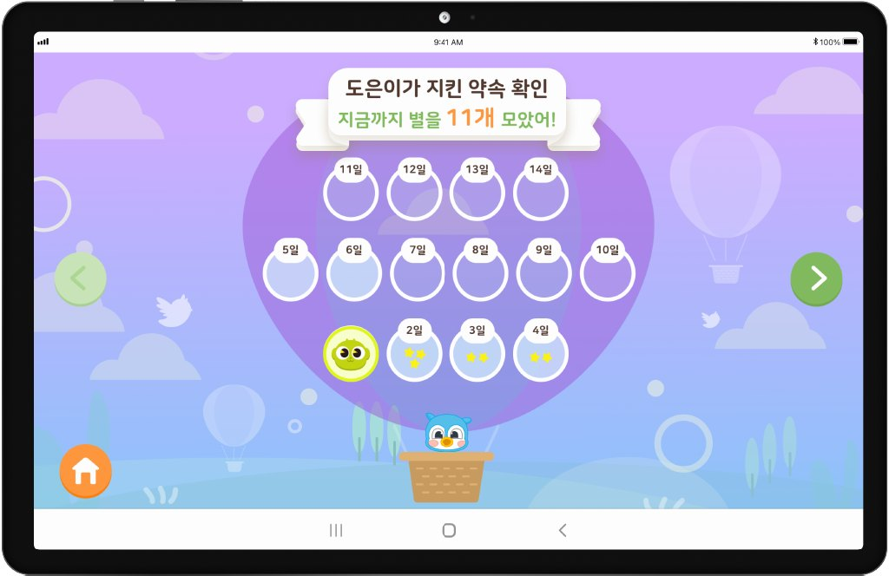

# ForMe case study — English

<!-- English text for case-study.md. Keep the field IDs; a section written here replaces the Korean section as a whole. -->

## Context <!-- case.section.context -->

ADHD is the most common mental disorder in childhood, yet most cases never reach diagnosis or treatment.

- 7.2% — prevalence of ADHD in children, the most common mental disorder before adolescence
- <1% — children diagnosed and treated in Korean national health insurance data, less than a fifth of those affected

At the core of ADHD is a deficit in executive function. Children who struggle to set goals, plan, regulate themselves and follow through find it hard to adapt to elementary school, where they must sit still at set times. Teachers often notice first, but the stigma around mental health makes it hard to suggest an assessment to parents.

We used the school as a platform and tested the service in a real setting. The child sets and carries out daily tasks by talking with ForMe, while parents follow along in a monitoring app and teachers on a web page.

- **ForMe · tablet app** · Child — Sets and carries out daily tasks
- **Monitoring app** · Parent — Follows the child's tasks and sends praise
- **Monitoring web** · Teacher — Sees how the class is using it

## Approach <!-- case.section.approach -->

Based on cognitive behavioural therapy (CBT), each promise is split into four steps.

- Step | What happens
- Goal | The child and a parent choose three promises to keep for the week
- Plan | At the promised time, the child tells ForMe what they planned to do
- Do | ForMe walks through each step so the child sees the promise through
- Check | Every night the child talks with ForMe about the promises kept that day

Reading, for example, goes from choosing a book → reading for the set time → saying what they thought → praising themselves.

## Conversation <!-- case.section.conversation -->

Even when the child's answer is wrong or missing, the conversation keeps going with a little more of a hint each time.

@defs mono

- ForMe — “Jiwon! What did we plan to do at this time? Tell me, Jiwon!”
- Correct — “Ding-dong!” and moves on to the next step
- Wrong · no answer · other — “Oh no! We planned to focus on something... can you tell me what it was?”
- Still stuck — Gives a closer hint with a picture of a book

The dialogue scenarios ran on the NAVER CLOVA Chatbot builder. The schedule the child sets triggers the system, so ForMe speaks first at the promised time. It is an Android tablet app left on the desk.

## Rewards <!-- case.section.rewards -->

Fun for the result, praise for the process.

- **Stars · AR character cards** · Result reward — The child gets a star for each promise kept, and a character card on days every promise is kept. Cards come alive through the AR camera.
- **Parents' voice praise** · Process reward — A praise guide, based on the child's progress and reinforcement praise theory, helps parents record a voice message.

※ Praise activities linked with home raise young children's self-esteem (Jang, 2012), and parents' responses shape positive self-esteem (Coopersmith, 1976).

## Screens <!-- case.section.screens -->

A tablet for the child, a phone for the parent

@hero

## Study <!-- case.section.study -->

Children kept using ForMe throughout the eight weeks.

- 76.1% — average 8-week usage among children with ADHD, borderline or mild intellectual disability — Doeun et al., 2023
- 8 weeks — improvements in self-efficacy and ADHD-related symptoms

### Follow-up study design

- Item | Details
- Participants | 500 children aged 6–8 and 500 parents, remote
- Duration | 6 weeks of ForMe use at home
- Measures | Pre/post emotional behaviour, depression and anxiety, attention, aggression, self-regulation, parental depression, ego resilience
- Digital biomarkers | Heart rate variability (HRV), eye tracking, voice
