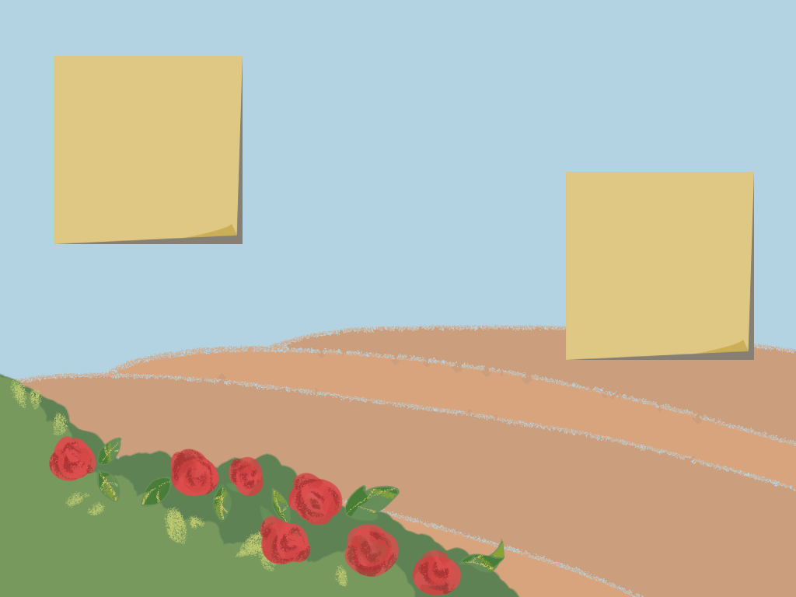
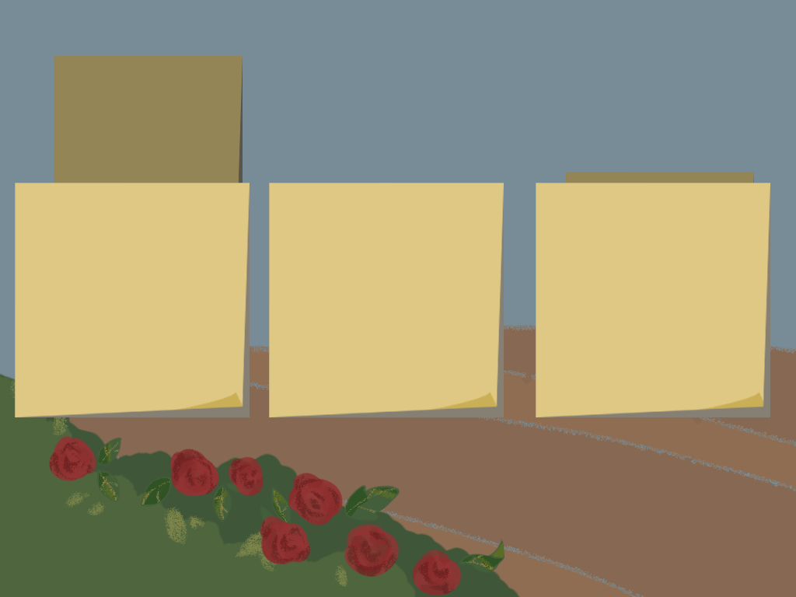
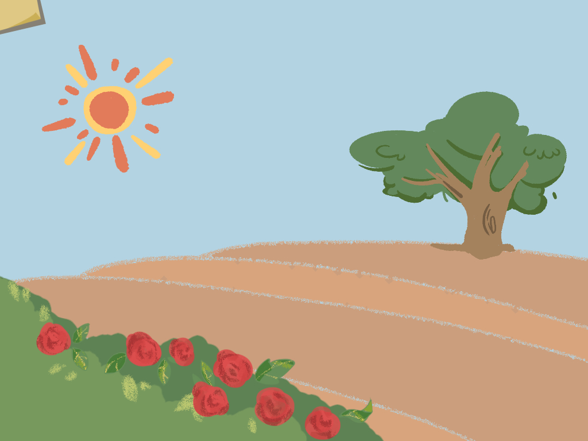
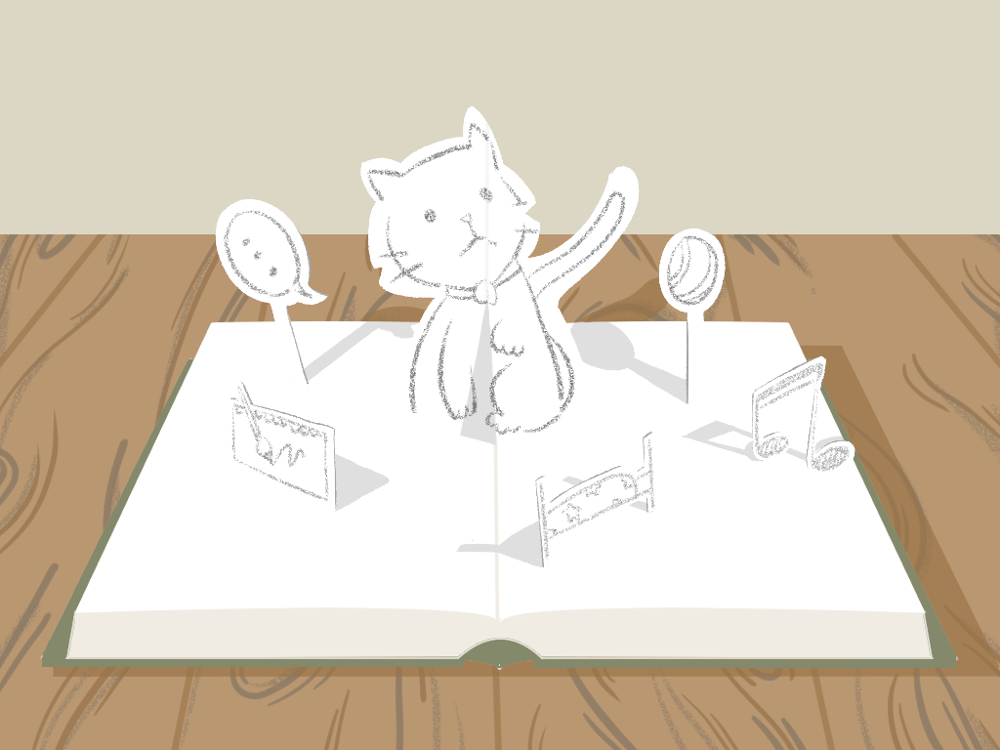

# KIKETCH case study — English

<!-- English text for case-study.md. Same section IDs and patterns. -->

## Market <!-- case.section.market -->

A kids' industry worth at least ₩40 trillion, and growing fast

@columns

- 2002: ₩8T
- 2007: ₩19T
- 2012: ₩27T
- 2017*: ₩40T

※ Korean kids' industry · KRW · *2017 is an estimate · Source: KT Economic Research Institute

@rows

- “Catch the ₩40 trillion kids' market”… IT firms add AI and AR — Yonhap News · 2018.05
- Growing kids' content market… major firms' sales up 40–60% in three years — Hankyoreh · 2019.07
- Catch the ‘eight-pocket’ generation… the kids' market grows despite the slump — MoneyS · 2019.09
- October's stock-market hot topics: kids, bio, foldables — Edaily · 2019.11

## Competition <!-- case.section.competition -->

No service combined emotional stimulation, printing and child-friendliness

- Criterion | Kiketch | Play-Doh Touch | PuppetPals | Catch Mind | YouTube Kids | KT Kidsland | Dubrain
- Emotional stimulation | ○ | × | × | × | △ | × | ×
- Story | ○ | × | ○ | × | ○ | ○ | ○
- Participatory | ○ | × | × | ○ | × | ○ | ○
- Variety · extensibility | ○ | × | △ | △ | ○ | ○ | ○
- Printing service | ○ | × | × | × | × | × | ×
- Uses real photos | ○ | ○ | ○ | × | × | ○ | ×
- Child-friendly | ○ | ○ | × | × | △ | △ | △

※ ○ yes · △ partly · × no · Source: SURF pitch deck

## Approach <!-- case.section.approach -->

The experience KIKETCH set out to give

1. **Everything, A to Z, is for the child**
2. **Focus on emotional development**
3. **Leave memories for a lifetime**

## Concept <!-- case.section.concept -->

A picture the child finishes themselves

The child picks an empty sticky note in a scene, draws on paper, and the drawing joins the scene to complete the picture.

#### A character of their own to love

