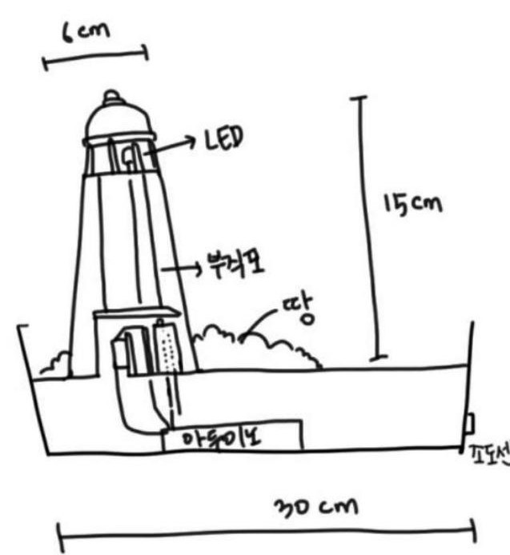
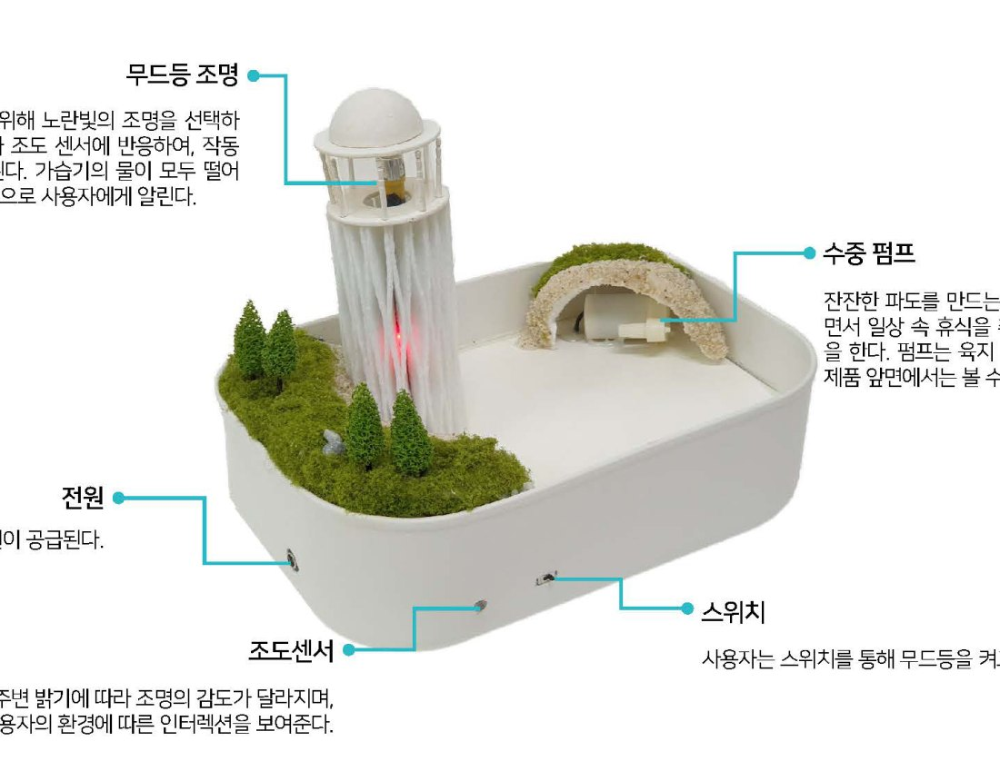
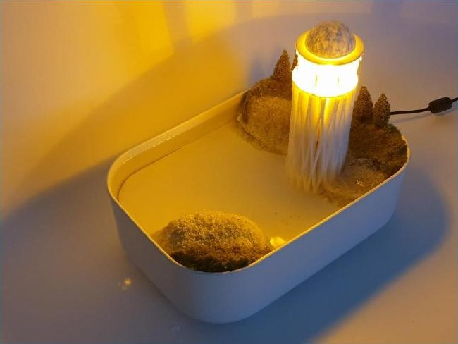
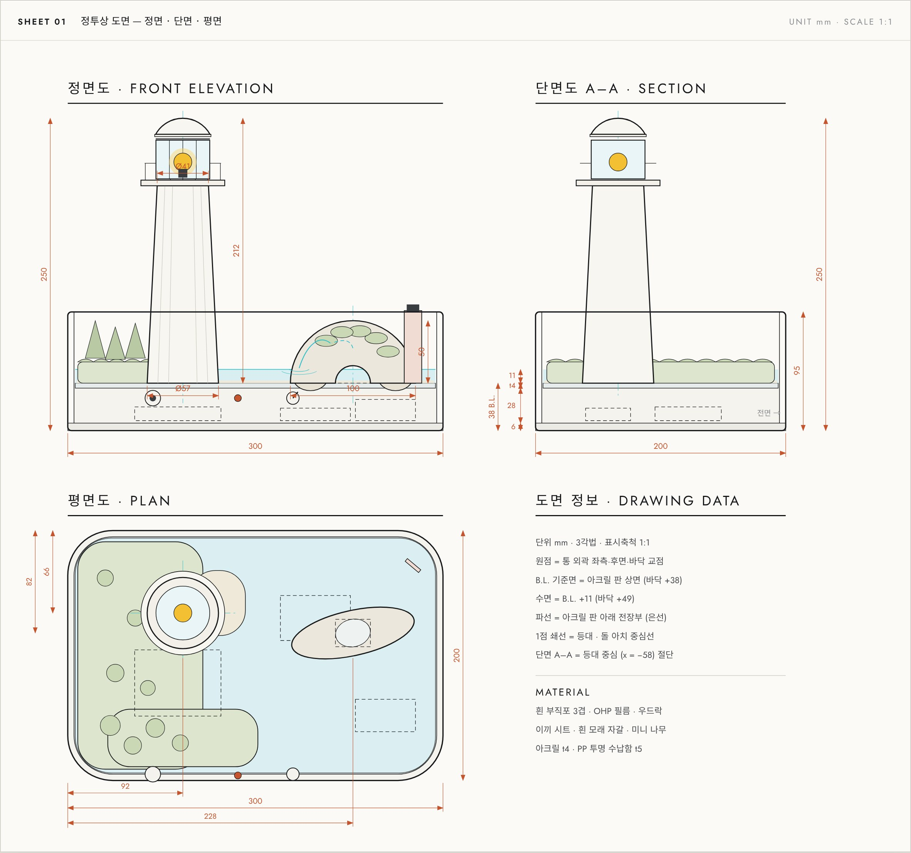
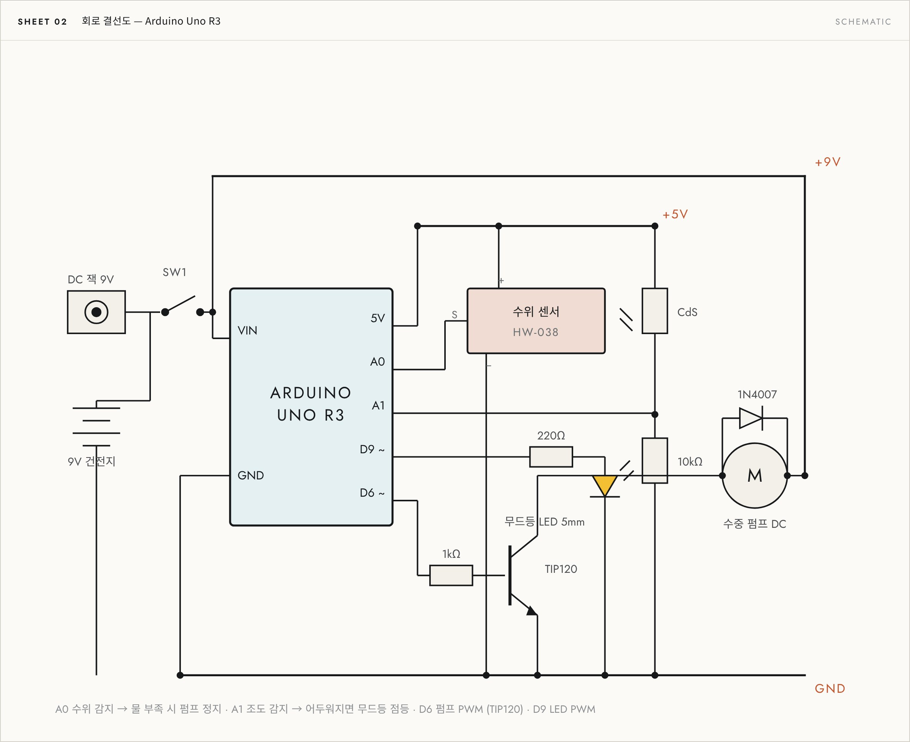
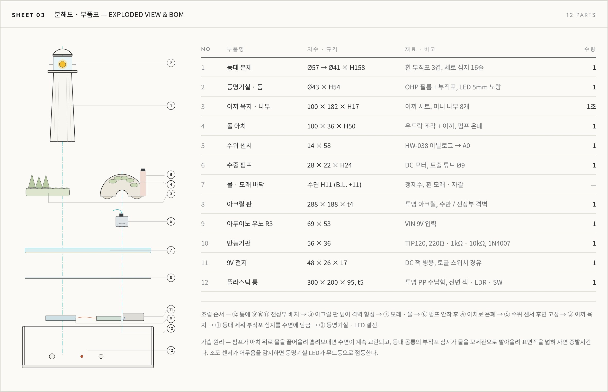

# THE LIGHTHOUSE 케이스 스터디

<!-- 자유 배치 케이스 스터디: `case.section.<id>` 섹션이 파일 순서대로 나옵니다. 작성 형식은 CONTENT_GUIDE.md의 '자유 배치 케이스 스터디'를 참고하세요. -->

## Concept <!-- case.section.concept -->

물을 부으면 등대에 불이 켜지고 잔잔한 파도가 치는 가습기 겸 무드등

- **부직포 가습기** · Organic — 플라스틱 디스크 대신 물의 기화 현상을 이용한 친환경 부직포 가습기
- **무드등** · Healing — 물을 붓는 순간 켜지는 조명. 주변 밝기에 따라 등대 불빛의 밝기가 달라진다
- **파도** · Nature — 등대가 있는 바닷가 풍경을 옮겨, 섬에 앉아 파도를 감상하는 경험

## References <!-- case.section.references -->

아두이노 수위 및 조도 센서 기반의 시스템 가동

@cards

- Water Lamp · Witaya Junma — 초음파 센서로 물이 차오르면 LED가 켜지는 전등. 물의 일렁임이 빛과 만나 벽면에 반사. // → 물을 스위치처럼: 수위 감지 센서 활용
- Night Light · Egrobotics — 조도 센서로 방이 어두워지면 켜지고 밝아지면 꺼지는 무드등 기능의 램프. // → 켜고 끄는 것을 넘어, 조도 값으로 밝기 조절

## Form <!-- case.section.form -->

수조 위의 섬과 바다, 등대를 형상화 한 가습기 디자인

## Specification <!-- case.section.specification -->

센서 두 개가 조명과 펌프를 움직인다.

- 부품 | 역할 | 동작
- 수위 센서 | 물 주입 감지 | 값 ≥ 300이면 조명과 펌프 켜짐, 물이 증발해 < 300이 되면 꺼짐 — 불이 꺼지는 것으로 물이 떨어졌음을 알림
- 조도 센서 | 주변 밝기 측정 | 값 200–600을 조명 밝기 1–255로 변환
- 등대 조명 | 무드등 | 노란빛 전구. 수위·조도 센서에 반응해 켜짐과 광량이 조절됨
- 수중 펌프 | 잔잔한 파도 | 육지 모형 아래에 배치
- 토글 스위치 | 전원 on/off | 사용자가 무드등을 켜고 끔
- 전원 | 12V 어댑터 | 외부 전원 공급

## Drawings <!-- case.section.drawings -->

정투상도, 회로도, 분해도로 제작 사양을 정리했다.

@stack

## 소개 <!-- case.intro -->

가습기의 플라스틱 디스크를 대체하고, 무드등과 잔잔한 물결을 결합해 일상 속 휴식 경험을 제공하는 방식을 탐색함.
