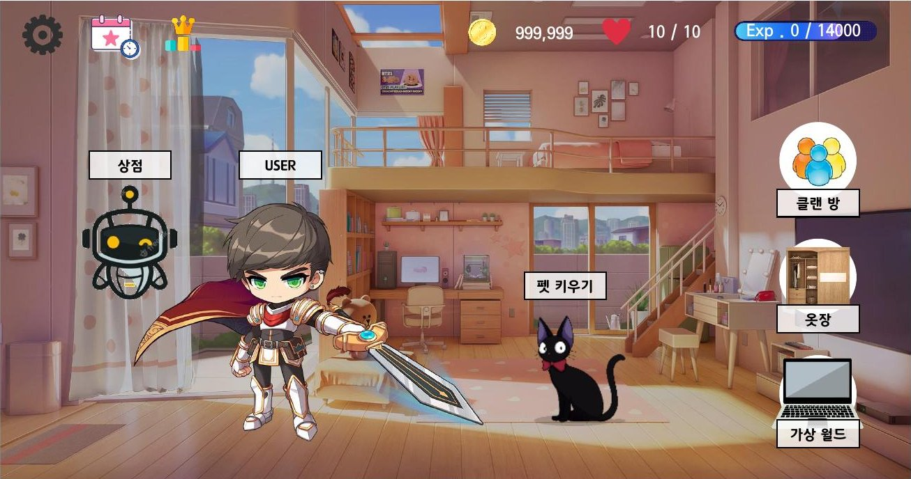
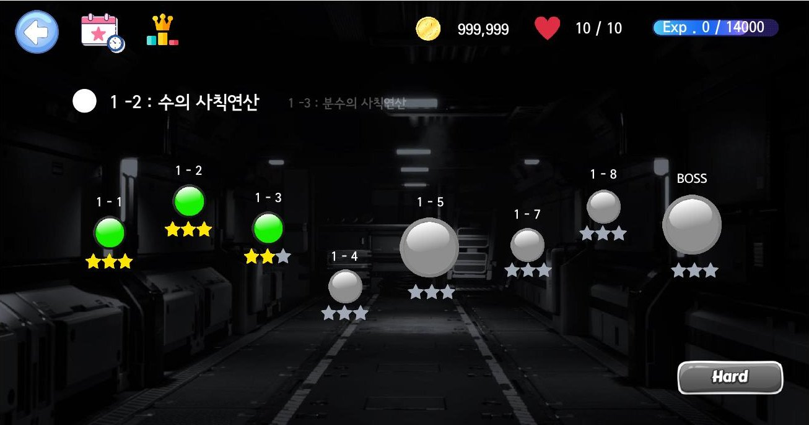
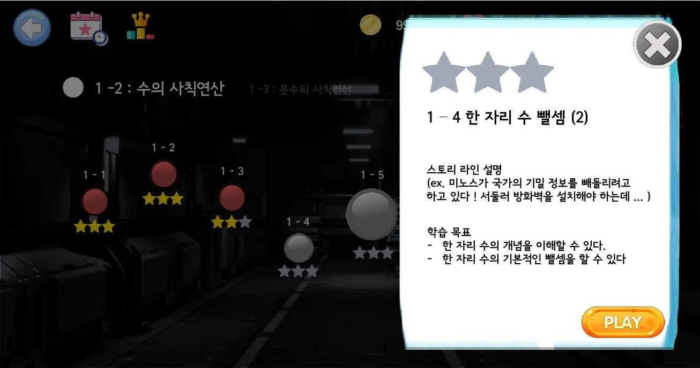
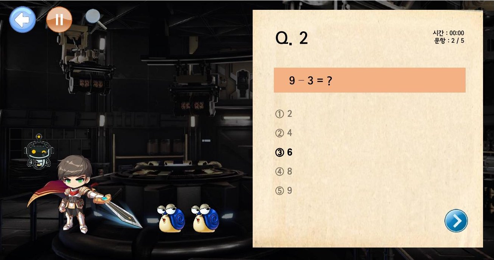
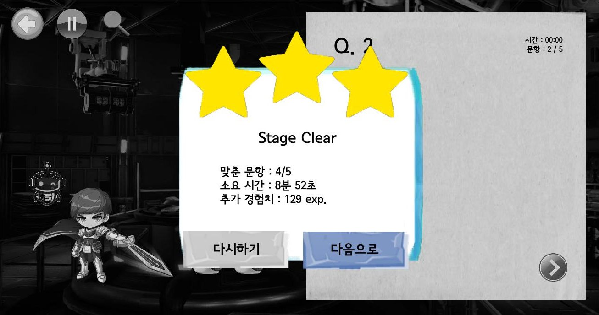
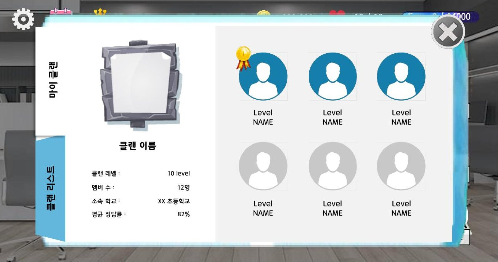

# MATH HERO 케이스 스터디

<!-- 자유 배치 케이스 스터디: `case.section.<id>` 섹션이 파일 순서대로 나옵니다. 작성 형식은 CONTENT_GUIDE.md의 '자유 배치 케이스 스터디'를 참고하세요. -->

## Overview <!-- case.section.overview -->

수학 문제를 풀어 해커 조직 ‘미노스’를 막는, 초등학생용 SF 수학 게임

평범한 초등학생인 플레이어는 인공지능 로봇 ‘코비’의 요청으로 가상현실 차원에 들어가, 수학 문제를 풀어 악성 코드를 제거하고 보안 툴을 설치하고 해커를 검거한다. 1학년부터 6학년까지 여섯 차원을 모두 지키면 게임이 끝난다.

- **Unity** · Platform — 유니티 게임
- **1인칭** · View — 1인칭 시점
- **SF** · Genre — 공상과학
- **6차원** · Stages — 차원마다 이지·노멀·하드

## Flow <!-- case.section.flow -->

접속부터 보상까지, 학교 단위로 함께 플레이한다.

1. **접속** — 로그인
2. **캐릭터** — 이름·성별·학교·학년
3. **튜토리얼** — 조작법·수학 수준 평가
4. **첫 보상** — 펫·아이템·방
5. **플레이** — 차원·난이도 선택
6. **보상** — 경험치·다음 단계

화면 구조 — 메인(상점·옷장·리더보드·이벤트·펫·방·클랜) → 맵(차원·난이도) → 플레이(문제·답변·힌트)

## Screens <!-- case.section.screens -->

UI 기획 — 메인, 맵, 플레이, 클랜

