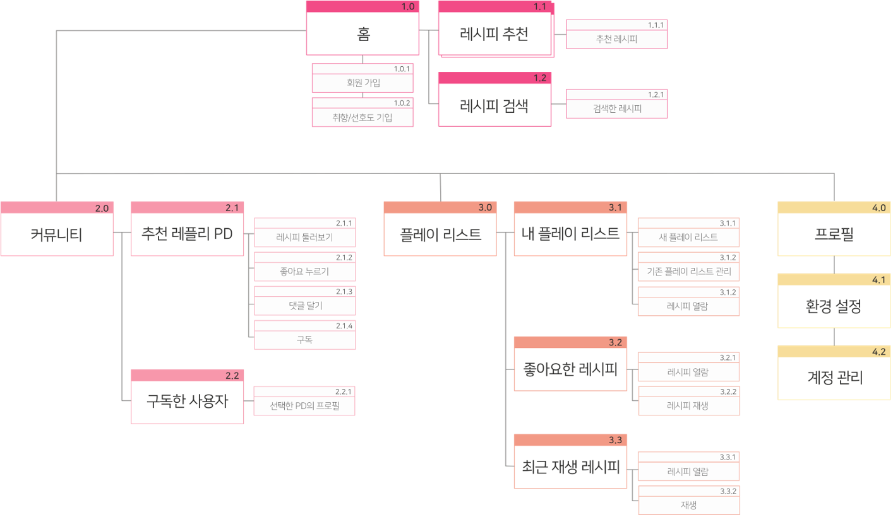

# Recipe Player case study — English

<!-- English text for case-study.md. Keep the field IDs; a section written here replaces the Korean section as a whole. -->

## Problem <!-- case.section.problem -->

Recipes are everywhere, but one that fits what is in my fridge and what I can actually cook is hard to find.

COVID-19 meant more single-person households cooking at home. From people in their twenties who had just started living alone to people in their thirties tired of eating out, the same frustrations kept coming up when finding and following recipes.

@cards

- Scattered channels — Recipes live across YouTube, blogs and recipe apps, and saved ones end up scattered too.
- Search that can't start from ingredients — It is hard to find dishes you can make with what is already at home.
- Instructions that don't fit your skill — Units and steps feel unfamiliar, and videos must be paused and replayed at every step.

## Research <!-- case.section.research -->

We interviewed five people, from a second-year student living alone to an office worker back with their parents after living alone, and coded what they said into behaviours and feelings.

@stack

### Utterances per coding category · CODED UTTERANCES

- Cooking behaviour: 60
- Recipe references: 37
- App expectations: 26
- Music-app behaviour: 15
- Reasons for not using apps: 13

### Most frequent codes · TOP CODES

- Personalised recipes: 11
- Simple cooking methods: 10
- Recipes that use leftovers: 8
- Hard to measure: 7
- Hard to handle the phone: 5
- Intuitive UI: 4
- Hard to use up leftovers: 4
- Clean UI: 3
- Voice recognition: 1

## Result <!-- case.section.result -->

##### Quote

- “When my hands are dirty mid-cooking, wiping them to touch the phone again is a hassle.” — P1 · lives alone
- “The video sweetens it with rice syrup, but I only had sugar, so I was stuck.” — P3 · job seeker
- “I don't really know what one teaspoon means… I couldn't get a feel for measuring.” — P4 · lives alone

##### Observed

@dash

- Ingredients at hand were more than a filter: they were where deciding the menu began.
- People who wanted to skim text quickly and people who preferred the clarity of video coexisted.
- Operating the screen mid-cooking and interpreting measuring units came up as the main difficulties.

## Persona <!-- case.section.persona -->

@persona

## Insights <!-- case.section.insights -->

1. **Ask what they have before asking what to eat** — The wish to use leftovers and the habit of choosing a menu from what is at hand appeared together. Ingredients should drive browsing, not sit inside the detail page.
2. **Let users choose how a recipe is shown and how fast it moves** — Some wanted to skim text or photos, others preferred video. Video plays by default, but steps can be skipped like a music playlist.
3. **Cut screen handling and unit interpretation while cooking** — Measurements are explained simply and visually, in terms of the tools the user already has.

## Storyboard <!-- case.section.storyboard -->

From choosing a menu to cooking, measuring, voice control and saving to a playlist

## Journey <!-- case.section.journey -->

@journey

## Outcome <!-- case.section.outcome -->

An information architecture from home recommendations and search to community, playlists and profile

## case.persona.name <!-- case.persona.name -->

Han Seon-woo

## case.persona.profile <!-- case.persona.profile -->

- Age: 23
- Role: University student · second year living alone
- Experience: Keen but not yet skilled; prefers simple dishes
- Browsing: Picks a menu from what is at hand and follows YouTube recipes

## case.persona.quote <!-- case.persona.quote -->

“I want a simple recipe app that **recommends recipes quickly and easily**, so I can sort out home meals!”

## case.persona.goals <!-- case.persona.goals -->

- Find simple, new dishes from what is at home
- Follow the cooking steps at my own pace
- Keep scattered recipes in one place and come back to them

## case.persona.frustrations <!-- case.persona.frustrations -->

- Searching several channels for a dish that uses what I have
- Pausing and replaying the video at every step
- Forgetting where I saved a recipe, so I never use it again

## case.journey.lead <!-- case.journey.lead -->

A to-be journey from ingredient-based recommendations to choosing, cooking and saving

## case.journey.stages <!-- case.journey.stages -->

### From my ingredients · DISCOVER

- Mood: Hopeful
- Moment: Picks food tastes and what is in the fridge, and finds a dish to make today.
- Pain: Has to search several channels over and over for dishes that use the leftovers
- Opportunity: Start browsing from ingredients at hand and taste

### Choose before cooking · CHOOSE

- Mood: Relieved
- Moment: Checks difficulty, time and ingredients, and picks a dish they can actually make.
- Pain: Missing ingredients or an unexpected difficulty sends them back to browsing
- Opportunity: Show what a dish needs up front, including substitutes

### Follow at my own pace · COOK

- Mood: At ease
- Moment: Follows the steps, controls playback and checks measurements in their own tools.
- Pain: Has to touch the screen with wet or dirty hands, and struggles to read exact units
- Opportunity: Auto-play cuts handling; measurements come in familiar units

### Save and share · KEEP

- Mood: Satisfied
- Moment: Saves recipes they liked to a playlist and leaves likes and comments.
- Pain: Recipes saved across many channels are hard to find again
- Opportunity: A playlist flow that keeps and reuses recipes in one place

### Come back · RETURN

- Mood: Hopeful
- Moment: Makes a saved recipe again or checks new recipes from creators they follow.
- Pain: May forget a recipe was saved, or miss new content from creators they like
- Opportunity: Build return visits on the playlist and let users follow list creators
