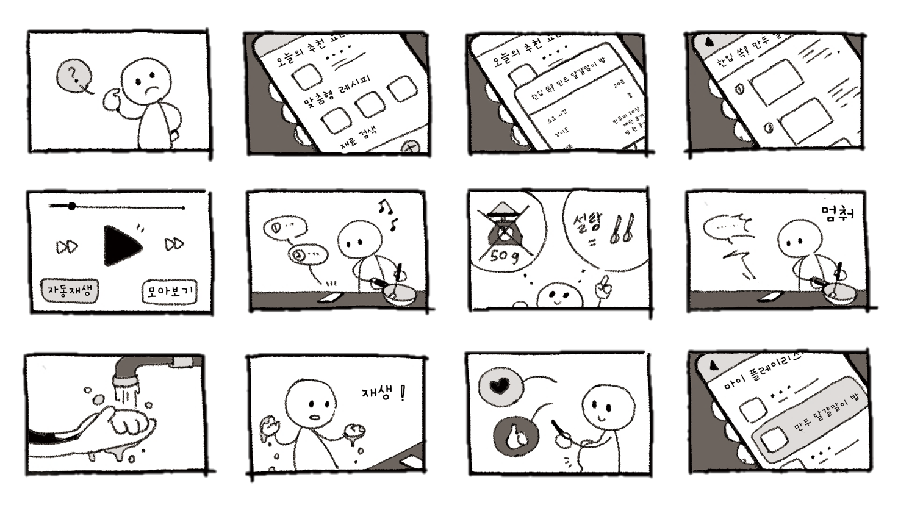

# Recipe Player 케이스 스터디

<!-- 자유 배치 케이스 스터디: `case.section.<id>` 섹션이 파일 순서대로 나옵니다. 작성 형식은 CONTENT_GUIDE.md의 '자유 배치 케이스 스터디'를 참고하세요. -->
<!-- @persona, @journey 줄은 아래 페르소나·저니 항목을 그 자리에 보여줍니다. -->

## Research <!-- case.section.research -->

자취 2년차 대학생부터 자취 경험 후 부모님과 사는 직장인까지 5명을 인터뷰하고, 발화를 행동과 느낌으로 나눠 질적 코딩

### 코딩 카테고리별 발화 수 · CODED UTTERANCES

- 요리행태: 60
- 레시피 참고: 37
- 앱 기대사항: 26
- 뮤직 앱 행태: 15
- 앱 미사용 이유: 13

### 가장 많이 나온 코드 · TOP CODES

- 개인 맞춤형 레시피: 11
- 간단한 조리 방식: 10
- 남은 재료를 활용한 레시피: 8
- 계량의 어려움: 7
- 휴대폰 조작이 어려움: 5
- 직관적 UI: 4
- 남은 재료 처리가 어려움: 4
- 깔끔한 UI: 3
- 음성 인식 기능: 1

### Verbatim

- “요리하던 중 손이 더러울 때 손을 닦고 핸드폰을 다시 만지는 게 귀찮다.” — P1 · 자취생
- “영상에서는 엿으로 단맛을 내는데, 나는 설탕만 있어서 난감했어.” — P3 · 취업 준비생
- “1 티스푼 이런 게 정확히 뭔지 모르겠고… 계량이 감이 안 잡혔어요.” — P4 · 자취생

### Observed

- 보유 재료는 필터를 넘어, 메뉴를 결정하는 출발점으로 쓰였다.
- 글자로 빠르게 확인하려는 사용자와 영상의 직관성을 선호하는 사용자가 공존했다.
- 요리 중 화면을 조작하는 일과 계량 단위를 해석하는 일이 주된 어려움으로 언급됐다.

## Persona <!-- case.section.persona -->

@persona

## Insights <!-- case.section.insights -->

1. **무엇을 먹을지 정하기 전에, 무엇을 가지고 있는지부터 묻기** — 남은 재료를 활용하고 싶다는 요구와 보유 재료로 메뉴를 결정하는 행동이 함께 나타났다. 재료 정보는 상세 페이지 안에만 둘 것이 아니라 탐색의 기준으로 써야 한다.
2. **레시피의 표현 방식과 진행 속도를 사용자가 고르게 하기** — 글자나 사진으로 빠르게 훑고 싶은 사용자와 영상을 선호하는 사용자가 공존했다. 영상 재생을 기본으로 하되, 음악 플레이리스트처럼 건너뛸 수 있게 한다.
3. **요리 중에는 화면 조작과 단위 해석을 함께 줄이기** — 계량 단위는 사용자가 가진 도구를 기준으로 양을 이해할 수 있도록 쉽고 직관적으로 안내한다.

## Storyboard <!-- case.section.storyboard -->

메뉴 선택부터 조리·계량·음성 조작·플레이리스트 저장까지

## Journey <!-- case.section.journey -->

@journey

## 페르소나 이름 <!-- case.persona.name -->

한선우

## 페르소나 사진 <!-- case.persona.photo -->

assets/case-study/persona.jpg

## 페르소나 정보 <!-- case.persona.profile -->

- 나이: 23세
- 역할: 대학생 · 자취 2년차
- 경험: 흥미는 높지만 숙련도는 낮고, 간단한 요리를 선호
- 탐색: 보유 재료로 메뉴를 정하고 유튜브 레시피를 참고

## 페르소나 한마디 <!-- case.persona.quote -->

“간단한 레시피 어플로 **쉽고 빠르게 레시피를 추천받아** 집밥을 해결하고 싶다!”

## 페르소나 목표 <!-- case.persona.goals -->

- 집에 있는 재료로 간단하고 새로운 요리 찾기
- 내 속도에 맞춰 조리 순서 따라가기
- 흩어진 레시피를 한곳에 보관하고 다시 확인하기

## 페르소나 불편 <!-- case.persona.frustrations -->

- 원하는 재료로 만들 메뉴를 여러 채널에서 검색해야 함
- 조리 단계마다 영상을 멈추고 다시 재생해야 함
- 저장한 레시피의 위치를 잊어 다시 활용하지 못함

## 저니 요약 <!-- case.journey.lead -->

재료 추천부터 선택·조리·저장까지를 다룬 To-be 여정

## 저니 단계 <!-- case.journey.stages -->

### 재료로 추천받기 · DISCOVER

- 감정: 기대
- 순간: 음식 취향과 냉장고에 있는 재료를 고르고 오늘 만들 요리를 찾는다.
- 불편: 남은 재료로 가능한 메뉴를 여러 채널에서 반복해서 찾아야 함
- 기회: 보유 재료와 취향을 탐색의 시작점으로 사용

### 조리 전 선택하기 · CHOOSE

- 감정: 안도
- 순간: 난이도·소요시간·필요 재료를 확인하고 만들 수 있는 요리를 선택한다.
- 불편: 재료가 없거나 조리 난이도를 예상하지 못하면 탐색으로 돌아감
- 기회: 요리에 필요한 조건을 미리 확인하고 대체 재료까지 안내

### 내 속도로 따라 하기 · COOK

- 감정: 편리함
- 순간: 조리 단계를 따라가며 재생을 조작하고 도구 기준 계량을 확인한다.
- 불편: 손이 젖거나 더러운 상태에서 화면을 만져야 하고 정량 단위를 해석하기 어려움
- 기회: 자동 재생으로 조작 부담을 줄이고 익숙한 계량 단위를 제안

### 저장하고 의견 나누기 · KEEP

- 감정: 만족
- 순간: 마음에 든 레시피를 플레이리스트로 저장하고, 좋아요와 댓글을 남긴다.
- 불편: 저장한 레시피가 여러 채널에 흩어져 있으면 다시 찾기 어려움
- 기회: 한곳에서 보관하고 재사용하는 플레이리스트 흐름

### 다시 꺼내 보기 · RETURN

- 감정: 기대
- 순간: 저장한 레시피를 다시 만들거나 관심 있는 제작자의 새 레시피를 확인한다.
- 불편: 저장했다는 사실을 잊거나 새 콘텐츠를 놓칠 수 있음
- 기회: 플레이리스트를 재방문의 기반으로 삼고 리스트 제작자를 구독
