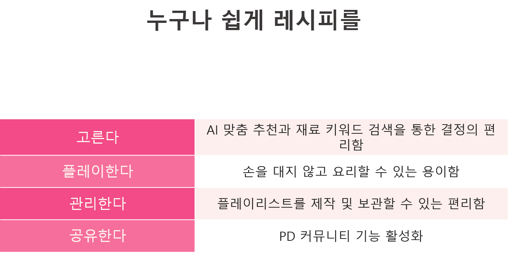
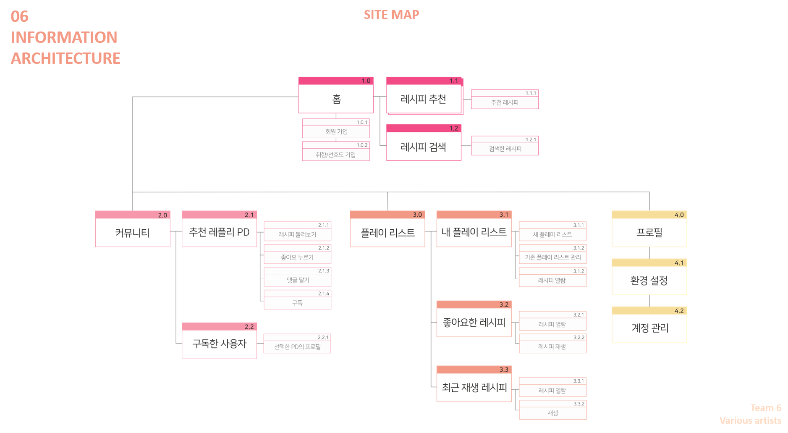

# REPLY 케이스 스터디

<!-- 블록 순서: Problem → Research → Persona → Insights → Journey → Key decisions → Outcome → Impact → Learnings → Design system -->
<!-- [대괄호]로만 된 항목은 빈칸으로 취급합니다. 필수 블록(Problem·Research·Insights·Key decisions·Outcome)은 빈칸 안내가 보이고, 선택 블록은 내용을 채우면 나타납니다. -->
<!-- 작성 형식은 CONTENT_GUIDE.md의 '케이스 스터디 블록'을 참고하세요. -->

## 문제 한 문장 <!-- case.problem.lead -->

1인 가구는 집에 있는 재료로 한 끼를 해결하고 싶지만, 재료를 준비하고 관리하는 데 어려움을 겪음. 특히 자취를 막 시작한 사용자는 요리와 레시피에 익숙하지 않아, 쉽게 고르고 따라 만들며 다시 찾아볼 수 있는 지원이 필요함.

## 문제를 만든 요인 <!-- case.problem.points -->

- 남은 재료 활용 — 냉장고에 있는 재료로 만들 수 있는 요리를 찾지만, 조건에 맞는 레시피를 추려내기 어려움.
- 계량과 준비 — 레시피의 계량 단위와 인분을 자신의 도구에 맞춰 해석하고, 없는 재료를 대체할 수 있는지 확인해야 함.
- 조리 중 화면 조작 — 손에 물이나 식재료가 묻은 상태에서 화면을 넘기거나 영상을 멈추고 다시 재생해야 함.
- 흩어진 레시피 — 여러 채널에서 찾은 레시피를 한곳에 보관하고 다시 찾기 어려움.

## 리서치 요약 <!-- case.research.lead -->

요리 관심도와 숙련도가 다른 20대 참여자 5명을 인터뷰하고, 응답을 행동·느낌·코드로 정리했음. 멘탈 모델과 페르소나를 구성한 뒤, 재료 선택부터 조리와 보관까지 필요한 지원을 요구사항으로 도출했음. 아래 그래프는 답변 유형별 코딩 빈도를 나타내며, 참여자 수나 비율을 의미하지 않음.

## 결과 · 막대그래프 <!-- case.research.bars -->

### 요리할 때의 어려움 · CODED MENTIONS
- 계량의 어려움: 7
- 휴대폰 조작의 어려움: 5
- 남은 재료 처리의 어려움: 4
- 대체 재료 선택의 어려움: 2
- 재료 구하기의 어려움: 2

### 레시피 앱에 대한 기대 · CODED MENTIONS
- 개인 맞춤형 레시피: 11
- 남은 재료를 활용한 레시피: 8
- 자체 타이머 기능: 2
- 다양한 종류의 레시피: 2
- 실용적인 레시피: 1

## 결과 · 큰 숫자 <!-- case.research.numbers -->

- 5명 — 요리 관심도·숙련도·거주 형태가 다른 인터뷰 참여자

## 결과 · 표 <!-- case.research.table -->

[- 가설 | 결과 | 데이터]

## 결과 · 인용 <!-- case.research.quotes -->

- “요리하던 중 손이 더러울 때 손을 닦고 핸드폰을 다시 만지는 게 귀찮다.” — P1
- “아 그리고 영상에서는 엿으로 단맛을 내는데, 나는 설탕만 있어.” — P3
- “음. 일단 1 티스푼 이런게 정확히 뭔지 모르겠고.. 계량?이 감이 안 잡혔어요.” — P4

## 결과 · 관찰 <!-- case.research.observed -->

- 보유 재료는 단순한 검색 필터를 넘어 메뉴를 결정하는 출발점으로 사용되었음.
- 글과 사진으로 빠르게 확인하려는 사용자와 영상의 직관성을 선호하는 사용자가 함께 나타났음.
- 조리 중 휴대폰을 조작하는 번거로움과 계량 단위를 해석하는 어려움이 주요 문제로 언급되었음.

## 결과 · 출처 <!-- case.research.source -->

[]

## 페르소나 이름 <!-- case.persona.name -->

한선우

## 페르소나 정보 <!-- case.persona.profile -->

- 나이: 23세
- 역할: 대학생 · 자취 2년차
- 요리 경험: 흥미는 높지만 숙련도는 낮고, 간단한 요리를 선호
- 탐색 방식: 보유 재료로 메뉴를 정하고 유튜브 레시피를 참고

## 페르소나 한마디 <!-- case.persona.quote -->

“간단한 레시피 어플로 쉽고 빠르게 레시피를 추천받아 집밥을 해결하고 싶다!”

## 페르소나 목표 <!-- case.persona.goals -->

- 집에 있는 재료로 간단하고 새로운 요리 찾기
- 내 속도에 맞춰 조리 순서 따라가기
- 흩어진 레시피를 한곳에 보관하고 다시 확인하기

## 페르소나 불편 <!-- case.persona.frustrations -->

- 원하는 재료로 만들 수 있는 메뉴를 여러 채널에서 반복해서 검색해야 함.
- 조리 단계마다 영상을 멈추고 다시 재생해야 함.
- 저장한 레시피의 위치를 잊어 다시 활용하지 못함.

## 인사이트 <!-- case.insights -->

### 무엇을 먹을지 정하기 전에, 무엇을 가지고 있는지부터 묻기
남은 재료를 활용하려는 요구와 보유 재료로 메뉴를 결정하는 행동이 함께 나타났음. 재료 정보를 상세 페이지에서 확인하는 데 그치지 않고, 레시피를 탐색하는 기준으로 활용하도록 설계했음.

### 레시피의 표현 방식과 진행 속도를 선택하게 하기
글과 사진으로 레시피를 빠르게 훑으려는 사용자와 영상을 선호하는 사용자가 함께 나타났음. 영상 재생을 기본으로 하되, 음악 플레이어처럼 단계를 건너뛰거나 조리 과정을 한눈에 확인할 수 있도록 설계했음.

### 화면 조작과 계량 단위 해석의 부담을 함께 줄이기
조리 중 화면을 만지는 번거로움과 계량 단위를 이해하는 어려움이 반복해서 언급되었음. 자동 재생과 음성 조작을 제안하고, 익숙한 도구를 활용한 계량 방법을 그림으로 안내하도록 설계했음.

## 저니 요약 <!-- case.journey.lead -->

재료 추천부터 선택·조리·저장·재방문까지 이어지는 To-be 여정임. 단계별 감정은 서비스 사용 시나리오에서 예상한 반응을 나타냅니다.

## 저니 단계 <!-- case.journey.stages -->

### 재료로 추천받기 · DISCOVER
- 감정: 기대
- 순간: 음식 취향과 냉장고에 있는 재료를 고르고, 오늘 만들 요리를 찾음.
- 불편: 남은 재료로 가능한 메뉴를 여러 채널에서 반복해서 찾아야 함.
- 기회: 보유 재료와 취향을 레시피 탐색의 시작점으로 활용함.

### 조리 전 선택하기 · CHOOSE
- 감정: 안도
- 순간: 난이도·소요시간·필요 재료를 확인하고 만들 수 있는 요리를 선택함.
- 불편: 재료가 없거나 난이도가 맞지 않으면 탐색으로 돌아가야 함.
- 기회: 요리에 필요한 조건을 미리 확인하고 대체 재료를 안내함.

### 내 속도로 따라 하기 · COOK
- 감정: 편리함
- 순간: 조리 단계를 따라가며 재생을 조작하고, 익숙한 도구를 기준으로 계량함.
- 불편: 손이 젖거나 더러운 상태에서 화면을 만져야 하고, 계량 단위를 해석하기 어려움.
- 기회: 자동 재생과 음성 조작으로 손의 사용을 줄이고, 익숙한 도구를 활용한 계량 방법을 제안함.

### 저장하고 의견 나누기 · KEEP
- 감정: 만족
- 순간: 마음에 든 레시피를 플레이리스트에 저장하고 좋아요와 댓글을 남김.
- 불편: 저장한 레시피가 여러 채널에 흩어져 있으면 다시 찾기 어려움.
- 기회: 한곳에서 레시피를 보관하고 다시 사용할 수 있는 플레이리스트를 제공함.

### 다시 꺼내 보기 · RETURN
- 감정: 기대
- 순간: 저장한 레시피를 다시 만들거나, 관심 있는 제작자의 새 레시피를 확인함.
- 불편: 저장한 사실을 잊거나 새로운 레시피를 놓칠 수 있음.
- 기회: 플레이리스트를 재방문의 기반으로 삼고, 제작자를 구독해 새 레시피를 받아볼 수 있도록 함.

## 핵심 결정 <!-- case.decisions -->

### 취향과 보유 재료로 레시피를 고르게 하기
사용자가 지금 만들 수 있고 먹고 싶은 요리를 찾도록, 취향 기반 추천과 재료 키워드 검색을 서비스의 출발점으로 삼았음. 난이도·소요시간·필요 재료를 미리 확인해 조리 전에 실행 가능성을 판단하도록 설계했음.

레플리의 목표는 레시피를 쉽게 고르고, 플레이하고, 관리하고, 공유하는 경험을 하나로 연결하는 것임.

- 근거: 인터뷰에서 보유 재료를 기준으로 메뉴를 정하는 행동과 개인 맞춤형 레시피에 대한 요구가 나타났음.
- 화면: pantry

### 음악 플레이어의 조작 방식을 조리 과정에 적용하기
레시피를 음악처럼 플레이할 수 있도록 자동 재생·일시정지·단계 건너뛰기·한눈에 보기를 제안했음. 손을 쓰기 어려운 조리 상황에는 음성 조작을, 계량이 낯선 사용자에게는 집에 있는 도구를 활용한 그림 안내를 제공하도록 설계했음.

스토리보드에서는 메뉴 선택, 단계별 조리, 계량, 음성 조작, 완료 후 저장까지 이어지는 사용 상황을 구체화했음.

- 근거: 조리 중 휴대폰 조작과 계량의 어려움이 반복해서 언급되었고, 레시피 매체에 대한 선호도 서로 달랐음.
- 화면: play

### 플레이리스트와 제작자 구독으로 보관과 공유를 연결하기
마음에 든 레시피를 플레이리스트에 모아 다시 찾고, 비슷한 취향의 제작자를 구독하도록 설계했음. 홈에서 레시피를 발견하고, 커뮤니티에서 제작자와 소통하며, 플레이리스트에서 보관한 레시피를 관리하는 정보구조를 구성했음.

- 근거: 여러 채널에 흩어진 레시피를 한곳에서 관리하고, 다양한 레시피와 의견을 공유하려는 요구를 반영했음.
- 화면: playlist

## 결과 <!-- case.outcome.lead -->

레플리는 취향과 보유 재료를 바탕으로 레시피를 고르고, 내 속도에 맞춰 조리하며, 마음에 든 레시피를 보관하고 공유하는 서비스임. 인터뷰에서 도출한 요구를 페르소나·사용 시나리오·스토리보드·정보구조·화면 설계로 구체화했음.

레시피 탐색에서 끝나는 경험을 넘어, 실제로 요리를 따라 만들고 다시 사용하는 과정까지 하나의 서비스로 연결했음.

## 바뀐 것 <!-- case.outcome.changes -->

[]

## 최종 화면 · flow.title <!-- case.flow.title -->

재료 선택 · 레시피 확인 · 조리

## 최종 화면 · flow.body <!-- case.flow.body -->

보유 재료를 탐색의 시작점으로 삼고, 조리 전에는 필요한 정보를 확인하며, 조리 중에는 단계별 안내를 따라가는 서비스 흐름임.

## 최종 화면 · hero.title <!-- case.hero.title -->

고르고, 플레이하고, 보관하는 레플리

## 최종 화면 · hero.body <!-- case.hero.body -->

취향과 재료에 맞는 레시피를 선택하고, 내 속도로 조리한 뒤, 플레이리스트에 보관해 다시 사용할 수 있도록 설계했음.

## 최종 화면 · before.title <!-- case.before.title -->

레시피 선택

## 최종 화면 · before.body <!-- case.before.body -->

취향과 보유 재료, 난이도와 소요시간을 기준으로 만들 수 있는 요리를 고릅니다.

## 최종 화면 · after.title <!-- case.after.title -->

조리와 보관

## 최종 화면 · after.body <!-- case.after.body -->

단계별 안내에 맞춰 조리하고, 마음에 든 레시피를 플레이리스트에 보관함.

## 임팩트 <!-- case.impact -->

[- PUBLICATION: … / - AWARD: … / - METRIC: …]

## 배운 점 <!-- case.learnings -->

리서치를 통해 레시피의 정보량뿐 아니라 정보를 제공하는 시점도 중요하다는 점을 배웠음. 재료와 난이도는 조리 전에, 계량과 진행 안내는 손을 사용하는 조리 중에 도움이 되어야 함.

또한 글·사진·영상에 대한 선호가 서로 달라, 하나의 보기 방식으로 모든 사용자의 요구를 충족하기 어렵다는 점을 확인했음. 익숙한 음악 플레이어의 조작 방식을 요리 상황에 적용하면서, 사용자가 표현 방식과 진행 속도를 선택할 수 있는 서비스 방향을 구체화했음.

## 디자인 시스템 <!-- case.system.body -->

[팔레트·타입·컴포넌트 원칙을 작성해 주세요. 원본에서 반드시 살린 요소가 있다면 함께 적어 주세요.]

## 디자인 시스템 · 팔레트 <!-- case.system.palette -->

[- `#HEX` 이름 형식으로 한 줄에 하나씩 작성하면 색 칩으로 표시됨.]

## 디자인 시스템 · 타입 <!-- case.system.type -->

[- 역할 | 글꼴 | 크기 / 행간]
