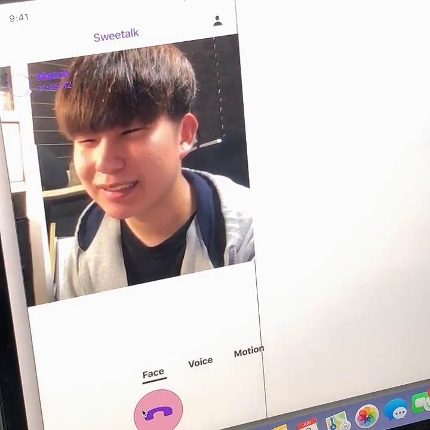

# Sweetalk case study — English

<!-- English text for case-study.md. Keep the field IDs; a section written here replaces the Korean section as a whole. -->

## Research <!-- case.section.research -->

Couples apart stay in touch online, yet rarely feel they spend time together.

“One third to 75% of young adults are currently or have been in a long-distance dating relationship at some point while attending college.” We studied couples in their 20s through a literature review, a survey, interviews and a diary study.

- 67% — meet their partner less than two days a month
- 84% — think it is a problem not to meet face to face
- 64% — try to make up for it when they cannot meet

## Design goals <!-- case.section.goals -->

Each requirement became one design goal.

- Requirement | Design goal | Filter
- **Non-verbal cues** — sense of being together, fewer misunderstandings | Support your own and partner’s nuance and expression | Face filter
- **Effective communication** — positive tone; problems handled lightly | Brighten the atmosphere | Voice filter
- **Full engagement** — attentive, considerate, closer | Share one time and space | Motion filter

## Concepts <!-- case.section.concepts -->

Three concepts came before the video call.

1. **VR application** — Online activities to enjoy together, beyond time and distance.
2. **Couple mode on KakaoTalk** — Avatars, a shared schedule and D-day inside the messenger couples already use.
3. **Independent application** — Knowing your partner better through shared moments and in-depth tests.

The final direction kept what the research valued most, non-verbal cues and a positive tone, in the video call couples already used to communicate in daily settings.

## System <!-- case.section.system -->

Three filters, each answering one design goal.

1. **Face filter** — Reads the user’s expression so both partners can see how they come across. // Input · Frowning or smiling on camera // Output · A prompt with a smile emoticon // Basis · 6/6 had misread a conversation because of a facial expression
2. **Voice filter** — Users choose words they don’t want to hear; the filter answers them with a joke. // Input · “Sick of it”, “Idiot” // Output · A playful caption or image that turns the moment into laughter // Basis · 5/6 had been frustrated by words they didn’t want to hear
3. **Motion filter** — Gestures become shared moments in the call. // Input · A body heart or a blown kiss // Output · Background music and effects with heart for both partners // Basis · Design goal 3, share one time and space

### Voice filter output

## Results <!-- case.section.results -->

Before the session, every couple recognised the problem. After it, every couple found the conversation more positive.

### Pre-session

- 5/6 — had been frustrated when their partner kept saying something they didn’t want to hear
- 6/6 — had misunderstood a conversation because of a facial expression

- “I didn’t want to hear that but I couldn’t directly say so, so it was much more frustrating.” — Participant #2

### Post-session

- 6/6 — found it helpful for a positive conversation
- 5/6 — found it reduced the negative atmosphere
- 3/6 — used it to reflect on their own expressions

- “I think we laughed a lot more than we talked without the filters.” — Participant #1
- “By looking at the subtitles I was able to realize, oh I was being cranky.” — Participant, post-session
