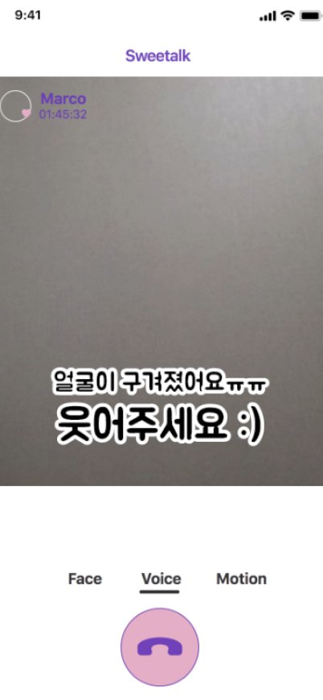
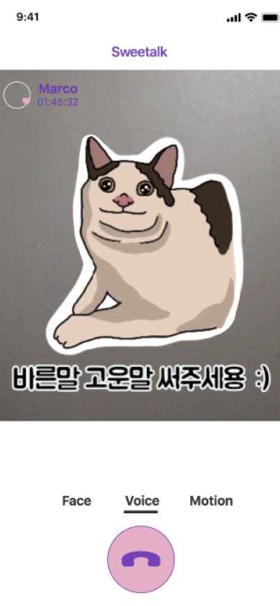
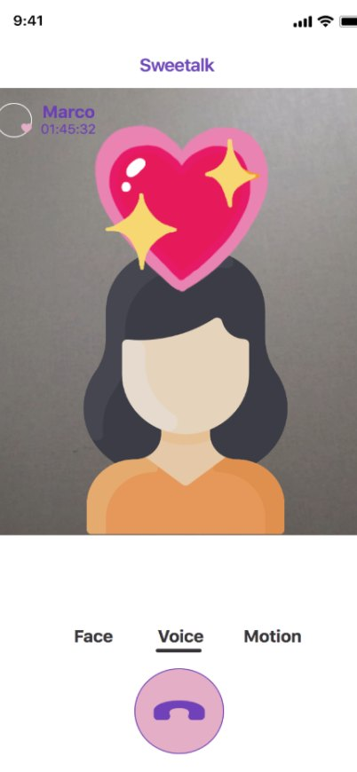

# Sweetalk 케이스 스터디

<!-- 자유 배치 케이스 스터디: `case.section.<id>` 섹션이 파일 순서대로 나옵니다. 작성 형식은 CONTENT_GUIDE.md의 '자유 배치 케이스 스터디'를 참고하세요. -->

## Research <!-- case.section.research -->

장거리 연인들은 자주 연락해도 함께 시간을 보내는 느낌을 갖기 어려움

문헌에서는 대학생의 장거리 연애 경험 비율이 조사에 따라 약 3분의 1에서 75%까지 보고됐다. 장거리 커플의 소통 경험을 이해하기 위해 문헌 조사·설문·인터뷰·다이어리 스터디를 진행했다.

- 67% — 한 달에 연인을 만나는 횟수가 2회 이하라고 응답
- 84% — 얼굴을 마주하고 만나지 못하는 점을 큰 어려움으로 꼽음
- 64% — 직접 만나지 못하는 상황을 보완하려고 노력함

## Design goals <!-- case.section.goals -->

20대 장거리 커플의 조사 결과를 세 가지 디자인 목표로 정리

- **비언어적 표현** · 요구 사항 1 — 함께 있다는 느낌, 오해 줄이기 => **표정이 전하는 뉘앙스를 잘 드러내기** · 디자인 목표 1 — → 표정에 반응하는 시각적 안내 제공
- **효과적인 소통** · 요구 사항 2 — 서운함을 전하더라도 사이가 나빠지지 않게 => **대화의 긴장을 유머로 완화하기** · 디자인 목표 2 — → 칭찬은 더 밝게, 서운함은 부드럽게
- **온전한 몰입** · 요구 사항 3 — 상대방의 말과 상황에 더 가깝게 => **멀리 있어도 함께 반응하는 느낌 만들기** · 디자인 목표 3 — → 몸짓에 반응하는 시각·청각 효과

## Concepts <!-- case.section.concepts -->

디자인 목표를 바탕으로 탐색한 세 가지 초기 콘셉트

1. **VR 애플리케이션** — 멀리서도 같은 가상 공간에서 함께 즐기는 활동
2. **카카오톡 커플 모드** — 익숙한 메신저에 아바타·공유 일정·기념일 기능을 더하는 방식
3. **커플 일기장** — 함께한 순간을 기록하고 질문에 답하며 서로를 알아가는 방식

탐색한 콘셉트 중, 표정과 말의 뉘앙스를 실시간으로 전달할 수 있는 영상 통화 필터를 최종으로 선택했다.

## System <!-- case.section.system -->

1. **얼굴 필터** —  // 표정에 따라 이모티콘과 안내를 띄워 상대에게 감정을 더 쉽게 전한다. // 입력 · 카메라 앞에서 찡그리거나 웃기 // 출력 · 웃는 이모티콘과 표정에 맞는 안내 // 근거 · 6/6이 표정 때문에 대화를 오해한 적이 있음
2. **목소리 필터** —  // 특정 말을 인식하면 장난스러운 자막으로 반응해 대화의 긴장을 완화한다. // 입력 · “지겨워”, “멍청이”, “짜증나” // 출력 · 웃음을 유발하는 장난스러운 자막 // 근거 · 5/6이 듣기 싫은 말 때문에 답답했던 적이 있음
3. **동작 필터** —  // 손 키스나 하트 동작에 음악과 효과가 더해져 함께 반응하는 순간을 만든다. // 입력 · 몸으로 만든 하트, 손 키스 // 출력 · 하트 애니메이션과 배경 음악·효과음 // 근거 · 6/6이 표정 때문에 대화를 오해한 경험이 있음

## Results <!-- case.section.results -->

평가에서 모두가 영상 필터가 긍정적인 대화에 도움이 됐다고 응답했다

### 세션 전

- 5/6 — 상대가 듣기 싫은 말을 반복할 때 답답함을 느낌
- 6/6 — 표정 때문에 대화를 오해한 경험이 있음

- ““듣기 싫었는데 직접 말할 수가 없어서 훨씬 더 답답했어요.”” — 참가자 #2

### 세션 후

- 6/6 — 필터가 긍정적인 대화에 도움이 됐다고 응답
- 5/6 — 대화의 부정적인 분위기가 줄었다고 응답
- 3/6 — 필터를 통해 자신의 표정을 돌아봤다고 응답

- ““필터 없이 이야기할 때보다 훨씬 많이 웃은 것 같아요.”” — 참가자 #1
- ““자막을 보고 아, 내가 짜증을 내고 있었구나 알게 됐어요.”” — 참가자 #5
